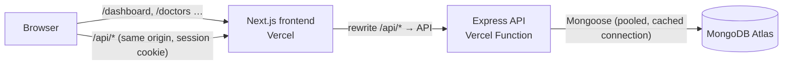

# Doctor Tracker — API

Doctor Tracker is a secure admin portal where hospital staff manage doctors and the patients under their care, and see at a glance how the caseload is changing. This repository is the **REST API**: a standalone Node.js + Express service backed by MongoDB. It handles authentication and role-based authorization, CRUD for doctors and patients with fast indexed search, filtering and pagination, and the aggregations behind the analytics dashboard. The Next.js frontend lives in a separate repository and talks to this API only over HTTP.

|                   |                                                                                                                             |
| ----------------- | --------------------------------------------------------------------------------------------------------------------------- |
| **Live API**      | https://doctor-tracker-api-five.vercel.app — health check at [`/health`](https://doctor-tracker-api-five.vercel.app/health) |
| **Live frontend** | https://doctor-tracker-web-pi.vercel.app                                                                                    |
| **Frontend repo** | https://github.com/OishwaryaRoy/doctor-tracker-web                                                                          |
| **Demo admin**    | `admin@doctortracker.test` / `Admin@12345` (full access)                                                                    |
| **Demo viewer**   | `viewer@doctortracker.test` / `Viewer@12345` (read-only)                                                                    |

## Tech stack

Node.js 20+ · Express 5 · TypeScript · MongoDB + Mongoose 9 · Zod 4 · JWT (httpOnly cookie) · bcrypt · Helmet · express-rate-limit · Pino · Vitest + Supertest + mongodb-memory-server · deployed on Vercel Functions.

## Setup guide

**Prerequisites:** Node.js ≥ 20.12, and either Docker (for a local MongoDB) or a MongoDB Atlas connection string.

```bash
git clone https://github.com/OishwaryaRoy/doctor-tracker-api.git
cd doctor-tracker-api
npm install
cp .env.example .env          # then edit MONGODB_URI and JWT_SECRET
```

Choose a database:

```bash
docker compose up -d          # local MongoDB on mongodb://localhost:27017 (matches .env.example)
```

…or paste your Atlas URI into `MONGODB_URI`. Then seed and start:

```bash
npm run seed                  # indexes + 2 demo users + 40 doctors + 3,000 patients
npm run dev                   # http://localhost:4000 (auto-reload)
```

**No database at all?** `npm run dev:memory` starts an in-memory MongoDB, seeds it and runs the API. Data is discarded on exit.

### Scripts

| Script                                  | What it does                                                                                                                                          |
| --------------------------------------- | ----------------------------------------------------------------------------------------------------------------------------------------------------- |
| `npm run dev`                           | Start with auto-reload (`tsx watch`)                                                                                                                  |
| `npm run dev:memory`                    | In-memory MongoDB + seed + start, zero setup                                                                                                          |
| `npm run seed`                          | Create indexes, upsert demo users, add demo data if the DB is empty. `-- --fresh` regenerates data; `-- --doctors=60 --patients=20000` changes volume |
| `npm run db:indexes`                    | Sync schema indexes (production has `autoIndex` off — run after schema changes)                                                                       |
| `npm test`                              | 54 integration tests against an in-memory MongoDB                                                                                                     |
| `npm run typecheck` / `lint` / `format` | Static checks                                                                                                                                         |
| `npm run build` / `start`               | Compile to `dist/` and run without tsx                                                                                                                |

### Environment variables

See [`.env.example`](.env.example). All variables are validated with Zod at startup; the process refuses to start with a clear message if one is missing or malformed.

| Variable               | Required | Default                 | Purpose                                          |
| ---------------------- | -------- | ----------------------- | ------------------------------------------------ |
| `MONGODB_URI`          | ✔        | —                       | MongoDB connection string                        |
| `JWT_SECRET`           | ✔        | —                       | HMAC secret for session tokens (≥ 32 chars)      |
| `JWT_EXPIRES_IN_HOURS` |          | `24`                    | Session lifetime                                 |
| `COOKIE_NAME`          |          | `dt_session`            | Session cookie name                              |
| `CLIENT_ORIGIN`        |          | `http://localhost:3000` | Comma-separated CORS allow-list                  |
| `PORT`                 |          | `4000`                  | Local port (`npm run dev`)                       |
| `LOG_LEVEL`            |          | `info`                  | Pino log level                                   |
| `SEED_*`               |          | see file                | Demo account credentials used by the seed script |

### Troubleshooting

- **`querySrv ECONNREFUSED _mongodb._tcp…`** when connecting to Atlas locally: your machine's DNS (often a VPN, ad blocker or local DNS proxy) refuses the SRV lookup that `mongodb+srv://` URIs need. Use Atlas's _standard_ connection string instead (`mongodb://host1:27017,host2:27017,host3:27017/doctor-tracker?ssl=true&replicaSet=…&authSource=admin`), shown under Connect → Drivers for older driver versions. Hosted environments such as Vercel are unaffected.
- **`Invalid environment variables`** on start: `.env` is missing or a value is malformed. Each line must be `NAME=value`, with no repeated `NAME=` and no quotes around the value.

## System architecture



**Request lifecycle inside the API**

```
request → helmet → cors → json (100 kB cap) → cookie-parser → pino-http
        → ensureDb (reuse cached connection)
        → /auth/*            (public: login is rate-limited)
        → requireAuth        (verify JWT from cookie or Bearer header)
        → router → requireRole('admin') on writes → validate(Zod) → controller → service → Mongoose
        → errorHandler       (one JSON error shape for every failure)
```

**Folder structure** — feature modules, each with the same layers:

```
src/
  config/       env (Zod-validated), db (cached connection), logger
  constants/    enum values shared by schemas, seed and /meta/options
  middleware/   auth (requireAuth, requireRole), validate, rateLimit, errorHandler
  modules/
    auth/       routes → controller → service, token helpers, schema
    doctors/    model (+indexes) · schema (Zod) · dto · service · controller · routes
    patients/   same layout
    stats/      dashboard aggregations
    meta/       option lists for filters/forms
    users/      user model + DTO
  utils/        ApiError, pagination, search tokens, shared Zod helpers
  app.ts        builds the Express app (no listen — used by tests and Vercel)
  server.ts     local entry: listen + graceful shutdown
api/index.js    Vercel entry: exports the compiled app (dist/) built by `npm run build`
scripts/        seed, index sync, in-memory dev server
tests/          integration tests (Supertest + in-memory MongoDB)
```

- **Controllers** only read validated input and shape HTTP responses.
- **Services** hold business rules and queries. They have no knowledge of Express.
- **DTOs** map documents to the public JSON shape, so internal fields (`passwordHash`, `searchTokens`, `__v`) never leak.

## API reference

Base path `/api/v1`. Every route except `/auth/login` and `/auth/logout` requires a session. Write operations (POST/PATCH/DELETE) also require the **admin** role; **viewer** is read-only.

| Method               | Path                               | Description                                                                                                                                                      |
| -------------------- | ---------------------------------- | ---------------------------------------------------------------------------------------------------------------------------------------------------------------- |
| POST                 | `/auth/login`                      | `{ email, password }` → sets the session cookie. Rate-limited: 10 failed attempts per 15 min per IP                                                              |
| POST                 | `/auth/logout`                     | Clears the session cookie                                                                                                                                        |
| GET                  | `/auth/me`                         | Current user                                                                                                                                                     |
| GET                  | `/doctors`                         | List. Query: `page`, `limit` (≤ 100), `search`, `specialization` (csv), `hospital`, `from`, `to` (date added), `sort` = `newest`·`oldest`·`name_asc`·`name_desc` |
| POST                 | `/doctors`                         | Create `{ name, specialization, hospital, phone, email }`                                                                                                        |
| GET                  | `/doctors/lookup`                  | `{ id, name, specialization }[]` for dropdowns. Query: `search`, `limit`                                                                                         |
| GET / PATCH / DELETE | `/doctors/:id`                     | Detail (with patient breakdown by condition) / update / delete. Delete returns 409 while the doctor has patients                                                 |
| GET                  | `/doctors/:id/patients`            | That doctor's patients (same filters as `/patients`)                                                                                                             |
| POST                 | `/doctors/:id/patients`            | Add a patient under the doctor                                                                                                                                   |
| DELETE               | `/doctors/:id/patients/:patientId` | Remove a patient from the doctor's list                                                                                                                          |
| GET                  | `/patients`                        | List. Query: `page`, `limit`, `search`, `condition` (csv), `gender` (csv), `doctor`, `from`, `to` (admission date), `sort`                                       |
| POST                 | `/patients`                        | Create, with `doctor` in the body                                                                                                                                |
| GET / PATCH / DELETE | `/patients/:id`                    | Detail / edit (send `null` to clear an optional field) / delete                                                                                                  |
| GET                  | `/stats/overview`                  | Dashboard data. Query: `from`, `to` (default: last 12 months), `interval` = `day`·`week`·`month` (auto if omitted), `tz` (IANA zone, default `UTC`)              |
| GET                  | `/meta/options`                    | Specializations, conditions, genders, blood groups, hospitals                                                                                                    |
| GET                  | `/health`                          | Liveness + database ping (outside `/api/v1`)                                                                                                                     |

**Dates.** `from`/`to` accept ISO datetimes (the frontend sends local day boundaries) or `YYYY-MM-DD`. A date-only `to` covers that whole day.

**Response shapes**

```jsonc
// list
{ "data": [ … ], "meta": { "page": 1, "limit": 10, "total": 3000, "totalPages": 300, "hasNextPage": true, "hasPrevPage": false } }
// single resource
{ "data": { … } }
// any error (400 validation, 401, 403, 404, 409 conflict, 429, 500, 503)
{ "error": { "code": "VALIDATION_ERROR", "message": "Request validation failed",
             "details": [ { "path": "body.email", "message": "Enter a valid email address" } ] } }
```

## Technical decisions

### 1. Word-prefix search on an indexed token array (instead of `$regex: /term/i` or `$text`)

Searching is the hottest path in an admin table: it runs on every debounced keystroke. The common approaches all fall short:

- **`{ name: /smi/i }`** (unanchored, case-insensitive) can't use an index. It scans every document, so the cost grows linearly with the collection.
- **`$text` indexes** only match whole stemmed words. Typing `joh` finds nothing until `john` is complete, which feels broken in a search-as-you-type box. They also can't be combined with a sort on another index.
- **Atlas Search** solves it, but it adds a separate search index and service, and it doesn't run locally or in tests.

**What we do:** every doctor and patient stores a `searchTokens` array.

- It holds each lowercase word of the name, hospital or diagnosis, plus the full email and the phone's digits.
- It is computed in a `pre('validate')` hook, so it can never drift from the source fields.
- It is covered by a multikey index.

A query like `jo sm` becomes `{ $and: [ { searchTokens: /^jo/ }, { searchTokens: /^sm/ } ] }`. Anchored, case-sensitive regexes on an indexed field turn into **index range scans**. Input is regex-escaped, so `.*` is matched literally (no ReDoS or wildcard tricks).

The trade-off is a little extra storage and write work, in exchange for fast, predictable reads that match how people search ("smith", "jo sm", "maria@", "415555"). `tests/query-plans.test.ts` asserts that every list, filter and search query's winning plan is an `IXSCAN`, never a `COLLSCAN`.

### 2. Serverless-ready Express with stateless, store-backed concerns

The API runs on Vercel Functions: many short-lived, horizontally scaled instances that share no memory. Several "default" Express patterns break in that model, so each was replaced deliberately:

| Concern             | Naive approach (breaks on serverless)                                                     | What we do                                                                                                                         |
| ------------------- | ----------------------------------------------------------------------------------------- | ---------------------------------------------------------------------------------------------------------------------------------- |
| DB connection       | `mongoose.connect()` per request → exhausts Atlas's connection limit                      | One connection promise cached on `globalThis`, reused while the instance is warm. Small pool, `bufferCommands: false` to fail fast |
| Index builds        | `autoIndex` runs `createIndex` for every index on each cold start                         | `autoIndex` off in production. Indexes are synced once with `npm run db:indexes` / the seed script                                 |
| Login rate limiting | In-memory counter → each instance has its own counter, multiplying an attacker's attempts | A custom `express-rate-limit` store in MongoDB: one atomic pipeline upsert per attempt, with a TTL index that expires the windows  |
| Sessions            | Server-side session store                                                                 | Stateless signed JWT (HS256 pinned, issuer checked) in an `httpOnly`, `SameSite=Lax`, `Secure` cookie                              |
| Patient counts      | A `patientCount` counter on Doctor (can drift; needs transactions)                        | Counted on read for the current page in one aggregation answered from the `{ doctor, admissionDate }` index                        |

The same `app.ts` runs unchanged under `npm run dev`, in the tests, and on Vercel. Only the entry point differs (`server.ts` vs `api/index.js`). The service could move to a container or VM without touching code.

## Performance & query optimization

- **Indexes match the queries.** Each index in `doctor.model.ts` / `patient.model.ts` has a comment naming the query it serves. Compound indexes follow _equality → sort → range_ order (e.g. `{ condition, admissionDate, _id }`).
- **Stable pagination.** Every sort ends with `_id`, so offset pages never repeat or skip rows when values tie.
- **Counts:**
  - The page query and `countDocuments` run in parallel.
  - With no filters, `estimatedDocumentCount()` reads collection metadata instead of scanning.
  - `limit` is capped at 100.
- **Lean reads.** `.lean()` plus explicit DTOs mean there's no document hydration on list endpoints. `populate` resolves a page's doctors with a single `$in` query.
- **One pass for the dashboard:**
  - All range-scoped breakdowns (timeline, conditions, genders, age groups, top doctors) share one `$match` on the indexed `admissionDate`, followed by a `$facet`.
  - `$lookup` runs only on the 10 grouped top doctors, not per patient.
  - KPI counts run in parallel.
  - Measured on the seed data (3,000 patients): ~25 ms per request locally.
- **Time-zone-correct buckets.** `$dateTrunc` groups in the viewer's IANA time zone, and empty buckets are zero-filled so charts don't skip periods.

## Security

- bcrypt (cost 12) password hashes, `select: false` on the hash field.
- Timing-safe login that compares against a dummy hash for unknown emails, plus one generic error message, so attackers can't tell which emails exist.
- JWTs: algorithm pinned to HS256, issuer verified, role validated.
- The cookie is `httpOnly`, so XSS can't read it. `SameSite=Lax` keeps it off cross-site POSTs (CSRF).
- Role-based authorization (`requireRole('admin')`) on every write.
- Zod validation on params, query and body. `.strict()` bodies reject unknown fields (mass assignment).
- The `simple` query parser blocks `?field[$ne]=` NoSQL injection.
- Helmet security headers, a CORS allow-list and a 100 kB body cap.
- Internal errors never leak stack traces in production.

## Testing

```bash
npm test
```

54 integration tests run against a real in-memory MongoDB (no mocks). They cover:

- **Auth:** cookie flags, user enumeration, rate limiting, tampered tokens, protected routes.
- **Authorization:** viewer vs admin.
- **Validation and error shapes.**
- **Behaviour:** pagination, search, every filter, CRUD, the delete guards, stats maths (including time-zone bucketing).
- **Query plans:** every list query uses an index.

## Deployment (Vercel)

1. **MongoDB Atlas:**
   - Create an M0 cluster and a database user.
   - Under _Network Access_, allow `0.0.0.0/0`. Vercel Functions have no fixed IPs on the free plan.
   - Pick the AWS region closest to your Vercel function region (e.g. `us-east-1` ↔ `iad1`).
2. **Vercel:**
   - _Add New → Project_, import this repo, and leave the framework preset as **Other**. `vercel.json` runs `npm run build` and routes every path to `api/index.js`, which loads the compiled app.
   - Set the environment variables: `NODE_ENV=production`, `MONGODB_URI`, `JWT_SECRET`. `CLIENT_ORIGIN` is optional.
3. **Seed once from your machine**, using the production URI:
   ```bash
   MONGODB_URI="<atlas-uri>" npm run seed
   ```
4. Check `https://<your-api-domain>/health` (live: https://doctor-tracker-api-five.vercel.app/health).

## Screenshots

UI screenshots (desktop and mobile) are in the [frontend repository's README](https://github.com/OishwaryaRoy/doctor-tracker-web#visual-evidence).
